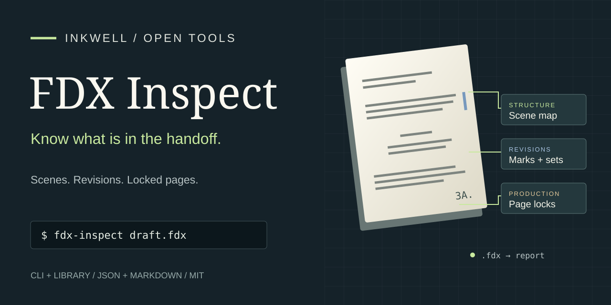

# FDX Inspect

**Know what is in the handoff.** Inspect a Final Draft screenplay from your
terminal: scene structure, revision references, locked-page markers, dual
dialogue and the details worth checking before an import.

Built by [Inkwell](https://www.inkwell.software/?utm_source=github&utm_medium=referral&utm_campaign=fdx_inspect&utm_id=github_fdx_inspect&utm_source_platform=github&utm_content=readme_inkwell),
the writing platform for drafting, co-writing and revision. Prefer a browser?
Open the [FDX Inspector](https://www.inkwell.software/tools/fdx-inspector?utm_source=github&utm_medium=referral&utm_campaign=fdx_inspect&utm_id=github_fdx_inspect&utm_source_platform=github&utm_content=readme_browser).

## Try the included screenplay

Requires Node.js 22.18 or later and pnpm 10.20.0.

```sh
git clone https://github.com/inkwell-app/fdx-inspect.git
cd fdx-inspect
pnpm install --frozen-lockfile
pnpm build
node dist/cli.js fixtures/handoff.fdx
```

The [original sample](fixtures/handoff.fdx) produces **3 scenes, 9 paragraphs,
1 revision set and 2 locked-page markers**. Its [complete report](docs/example-report.md)
shows the scene map and suggested handoff checks.

## Inspect your files

```sh
# Read a report in your terminal
node dist/cli.js draft.fdx

# Save machine-readable results for several files
node dist/cli.js --json drafts/*.fdx > reports.json

# Fail CI on structural warnings
node dist/cli.js --strict --json draft.fdx

# Read from a pipe; keep the full counts but omit the scene map
node dist/cli.js --json --max-scenes 0 - < draft.fdx
```

| Result | What to do next |
| --- | --- |
| Readable, no warnings | Continue the handoff; compare formatting in the receiving application |
| Revision or locked-page signals | Compare colors, page labels and numbering against your production PDF |
| Missing revision sets or unknown structure | Review the finding before relying on the import |
| Unreadable | Export a fresh FDX file and inspect it again |

Exit codes: **0** readable; **1** warnings with `--strict`; **2** unreadable
input, a file error or invalid arguments. Informational production features
do not fail strict mode. A batch returns the highest exit code among its files.

Work through a [warning and failed CI batch](docs/cli.md#work-through-a-warning-and-a-failed-batch),
then read the [CLI guide](docs/cli.md), [report reference](docs/report.md) and
[handoff workflow](docs/handoff.md).

## Use the library

```js
import { readFileSync } from 'node:fs'
import { inspectFdx, formatMarkdown } from './dist/inspect.js'

const report = inspectFdx(readFileSync('draft.fdx', 'utf8'), { maxScenes: 500 })
console.log(formatMarkdown(report))
```

The library returns a deterministic [versioned report](schemas/report.schema.json).
The CLI's JSON wraps reports in a [batch envelope](schemas/batch.schema.json),
with one result per input, including file errors.

## Test an interchange edge case

Use the original, MIT-licensed
[screenplay-interop fixtures](https://github.com/inkwell-app/screenplay-interop):

```sh
git clone https://github.com/inkwell-app/screenplay-interop.git ../screenplay-interop
node dist/cli.js --fixture fdx-locked-pages --fixtures-dir ../screenplay-interop
```

FDX Inspect inventories XML signals. It does not paginate a screenplay, convert
it, or predict every importing application's behavior. Reports contain counts
and structural positions; screenplay text and metadata values are not included.
See [coverage and limits](docs/report.md#coverage-and-limits) when building on it.

## Keep writing

| Your next step | Resource |
| --- | --- |
| Draft and revise a screenplay | [Inkwell Plot](https://www.inkwell.software/plot?utm_source=github&utm_medium=referral&utm_campaign=fdx_inspect&utm_id=github_fdx_inspect&utm_source_platform=github&utm_content=readme_plot) |
| Prepare an import | [FDX import guide](https://www.inkwell.software/resources/guides/import-fdx?utm_source=github&utm_medium=referral&utm_campaign=fdx_inspect&utm_id=github_fdx_inspect&utm_source_platform=github&utm_content=readme_import) |
| View an FDX without Final Draft, export a PDF, or convert a PDF to Fountain | [Screenplay converter](https://www.inkwell.software/tools/screenplay-converter?utm_source=github&utm_medium=referral&utm_campaign=fdx_inspect&utm_id=github_fdx_inspect&utm_source_platform=github&utm_content=readme_converter) |
| Move your scripts out of Final Draft | [Switch from Final Draft](https://www.inkwell.software/resources/migrate/from-final-draft?utm_source=github&utm_medium=referral&utm_campaign=fdx_inspect&utm_id=github_fdx_inspect&utm_source_platform=github&utm_content=readme_migrate) |
| Deliver locked production pages | [FDX handoff guide](https://www.inkwell.software/learn/fdx-handoff?utm_source=github&utm_medium=referral&utm_campaign=fdx_inspect&utm_id=github_fdx_inspect&utm_source_platform=github&utm_content=readme_fdx_handoff) |
| Test an importer against known edge cases | [Screenplay interoperability fixtures](https://github.com/inkwell-app/screenplay-interop) |
| Plan a revision or handoff | [Writing Handbook](https://github.com/inkwell-app/writing-handbook) |
| Find writing tools and references | [Inkwell resources](https://www.inkwell.software/resources?utm_source=github&utm_medium=referral&utm_campaign=fdx_inspect&utm_id=github_fdx_inspect&utm_source_platform=github&utm_content=readme_resources) |
| Compare plans | [Inkwell pricing](https://www.inkwell.software/pricing?utm_source=github&utm_medium=referral&utm_campaign=fdx_inspect&utm_id=github_fdx_inspect&utm_source_platform=github&utm_content=readme_pricing) |

## Contribute

Bring a small reproducible file, a clearer finding or a useful integration.
Start with [CONTRIBUTING.md](CONTRIBUTING.md). Report vulnerabilities through
[SECURITY.md](SECURITY.md).

Code, original examples and graphics are MIT-licensed. See
[sources and credits](docs/sources.md). Final Draft is a trademark of its owner;
this project is independently developed by Inkwell.
